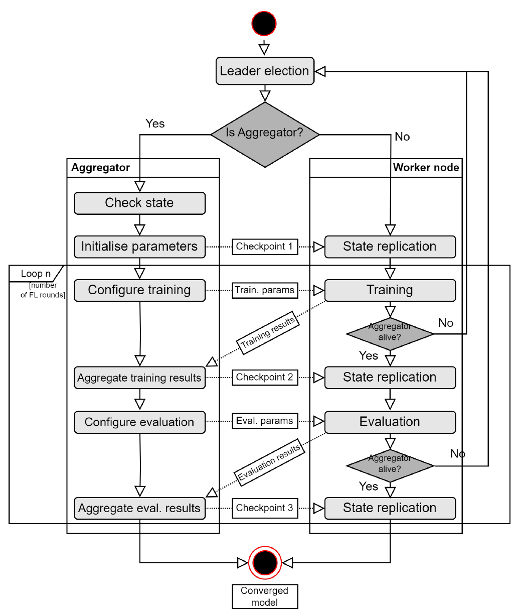

# รายงานย่อบทความ Raft-FL

## 1 ข้อมูลผู้จัดทำและระเบียนบทความ

**ชื่อบทความ:** Raft Protocol for Fault Tolerance and Self-Recovery in Federated Learning  
**ชื่อภาษาไทย:** การใช้โปรโตคอล Raft เพื่อความทนทานต่อความผิดพลาดและการกู้คืนตนเองในการเรียนรู้แบบสหพันธ์  
**ผู้เขียน:** Rustem Dautov และ Erik Johannes Husom (SINTEF Digital ประเทศนอร์เวย์)  
**งานประชุม:** 2024 IEEE/ACM 19th Symposium on Software Engineering for Adaptive and Self-Managing Systems (SEAMS) เมืองลิสบอน ประเทศโปรตุเกส หน้า 110-121  
**IEEE Doc ID:** 10556381 | **DOI:** 10.1145/3643915.3644093  
**ผู้จัดทำ:** นายธีรภัทร์ ภู่ระยา ลำดับที่ 10  
**รหัสนิสิต:** 66362416  
**รายวิชา:** 305432 เครือข่ายเซนเซอร์ (Assignment Paper 3)

บทความนี้เผยแพร่แบบ Open Access ภายใต้สัญญาอนุญาต Creative Commons Attribution 4.0 และดาวน์โหลดจาก IEEE Xplore โดยตรง เนื่องจาก SEAMS เป็นงานประชุมที่ IEEE และ ACM ร่วมกันจัด เลข DOI จึงออกโดย ACM (ขึ้นต้นด้วย 10.1145) ส่วนระเบียนบน IEEE Xplore จัดอยู่ในประเภท IEEE Conferences ภายใต้ IEEE Doc ID 10556381 รายงานฉบับนี้จึงอ้างอิงทั้งสองหมายเลขควบคู่กันเสมอ

## 2 บทคัดย่อฉบับแปลและแรงจูงใจ

การเรียนรู้แบบสหพันธ์ (Federated Learning: FL) เป็นแนวทางการเรียนรู้ของเครื่องที่ให้อุปกรณ์ปลายทาง เช่น อุปกรณ์ IoT หรือ edge server ฝึกโมเดลด้วยข้อมูลของตนเอง แล้วส่งเฉพาะพารามิเตอร์ของโมเดลไปยังเครื่องกลางที่เรียกว่า aggregator เพื่อรวมเป็นโมเดลเดียว [4] แม้ข้อมูลจะกระจายอยู่ที่ปลายทาง แต่ขั้นตอนการรวมโมเดลยังรวมศูนย์อยู่ที่ aggregator เพียงเครื่องเดียว aggregator จึงเป็นจุดล้มเหลวจุดเดียว (Single Point of Failure: SPOF) ของทั้งระบบ [1] เมื่อเครื่องนี้ดับ การฝึกจะหยุดลงทันทีและความคืบหน้าที่ยังไม่ได้บันทึกจะสูญหาย

ผู้เขียนเสนอให้ทุกโหนดในคลัสเตอร์ FL รันโค้ดชุดเดียวกัน แล้วใช้กลไกการเลือกผู้นำ (Leader Election) และการทำสำเนาบันทึก (Log Replication) ของโปรโตคอลฉันทามติ Raft เป็นตัวตัดสินว่าโหนดใดจะทำหน้าที่ aggregator พร้อมทั้งทำสำเนาสถานะการฝึกไปยังทุกโหนด เมื่อ aggregator ดับ โหนดที่เหลือจะเลือกผู้นำคนใหม่ และผู้นำคนใหม่จะฝึกต่อจากจุดบันทึก (checkpoint) ล่าสุดได้ทันที ต้นแบบพัฒนาบนเฟรมเวิร์ก Flower [3] ร่วมกับไลบรารี PySyncObj และผู้เขียนเปิดเผยซอร์สโค้ดไว้ที่ github.com/SINTEF-9012/raft_flower

ผู้เขียนทดลองบนคลัสเตอร์ Raspberry Pi 3 จำนวน **11 บอร์ด** ด้วยการฝึก CNN บนชุดข้อมูล CIFAR-10 ผลการทดลองพบว่าโหนดที่เหลือเลือก aggregator ใหม่ได้ทุกครั้งและฝึกต่อจนจบ โดยใช้เวลาเลือกใหม่ **1.27 วินาที** เมื่อมี worker 1 ตัว และ **3.76 วินาที** เมื่อมี worker 10 ตัว สิ่งที่ต้องแลกคือทราฟฟิกเครือข่ายต่อหนึ่งรอบการฝึกที่เพิ่มจาก **0.98 ถึง 9.8 MB** ของ Flower เดิม เป็น **1.77 ถึง 49.1 MB** เมื่อเพิ่ม Raft ผู้เขียนสรุปว่าทราฟฟิกสูงขึ้นประมาณ 5 เท่า แต่เมื่อคำนวณอัตราส่วนจากตัวเลขในกราฟจะได้ **1.8 ถึง 5.0 เท่า** ซึ่งเข้าใกล้ 5 เท่าเฉพาะเมื่อมี worker 9 ถึง 10 ตัว

ในเครือข่ายเซนเซอร์และระบบ IoT อุปกรณ์ปลายทางมักเชื่อมต่อได้ไม่ต่อเนื่อง ใช้พลังงานจากแบตเตอรี่ และติดตั้งในจุดที่เข้าไปดูแลได้ยาก ความทนทานของ aggregator จึงเป็นเงื่อนไขสำคัญของการนำ FL ไปใช้งานจริง ผู้เขียนระบุความท้าทายที่ทางแก้ต้องตอบไว้ 3 ประการ ดังนี้

1. **การพึ่งพา aggregator เครื่องเดียว:** ความล้มเหลวของโหนดกลางเพียงเครื่องเดียว ไม่ว่าจะเกิดจากฮาร์ดแวร์ เครือข่าย หรือเหตุไม่คาดคิด ทำให้กระบวนการเรียนรู้ทั้งหมดหยุดชะงัก (Section 2.1)
2. **ทางเลือกเดิมหนักเกินไปสำหรับอุปกรณ์ที่ทรัพยากรจำกัด:** gossip learning และ swarm learning ยังซับซ้อนเกินกว่าจะนำไปใช้ซ้ำได้ทั่วไป ส่วน Distributed Ledger Technology (DLT) ใช้พลังประมวลผล พื้นที่จัดเก็บ และพลังงานสูง งานที่ใกล้เคียงที่สุดของ Behera และคณะ [6] ใช้ Raft เลือกผู้นำใหม่ แต่ไม่ทำสำเนาสถานะการฝึก (Section 3)
3. **ต้องไม่เพิ่มภาระให้ software stack:** ทางแก้ควรผนวกเข้ากับเฟรมเวิร์ก FL ที่ใช้อยู่ได้โดยตรง แทนการพึ่งเครื่องมือภายนอกที่มีขนาดใหญ่ (Section 2.1)

## 3 สถาปัตยกรรมและกลไก Raft Self-Recovery

### 3.1 หลักการทำงานของ Raft

Raft เป็นอัลกอริทึมฉันทามติที่ Ongaro และ Ousterhout [2] ออกแบบให้เข้าใจง่ายกว่า Paxos บทความสรุปหลักการไว้ใน Section 4.1 และแนะนำให้ศึกษารายละเอียดภายในจากบทความต้นฉบับของ Raft โหนดแต่ละตัวจะอยู่ในสถานะใดสถานะหนึ่งจากสามสถานะ คือ follower, candidate และ leader โดยเวลาถูกแบ่งเป็นช่วงที่เรียกว่า term กลไกสำคัญมีดังนี้

1. **Election timeout:** follower ที่ไม่ได้รับ heartbeat จากผู้นำจนครบเวลาที่สุ่มไว้ จะเปลี่ยนเป็น candidate เพิ่มหมายเลข term และขอคะแนนเสียงจากโหนดอื่น การสุ่มเวลาช่วยลดโอกาสที่หลายโหนดแย่งคะแนนกันจนไม่มีผู้ชนะ (split vote)
2. **Majority vote:** candidate ที่ได้คะแนนเสียงข้างมากของสมาชิกทั้งหมดจะเป็นผู้นำของ term นั้น
3. **Heartbeat:** ผู้นำส่งข้อความเป็นระยะเพื่อยืนยันว่ายังทำงานอยู่ เมื่อข้อความขาดหายนานเกิน timeout จะเกิดการเลือกตั้งรอบใหม่
4. **Log replication:** ผู้นำส่งรายการบันทึก (log entry) ไปยัง follower และถือว่ารายการนั้น commit แล้วเมื่อเสียงข้างมากตอบรับ

เงื่อนไขเสียงข้างมากเป็นตัวกำหนดขีดจำกัดความทนทานของคลัสเตอร์ หาก N คือจำนวนสมาชิกทั้งหมด จำนวนเสียงขั้นต่ำ (quorum) และจำนวนโหนดที่ดับพร้อมกันได้มากที่สุดเป็นดังนี้

Q = ⌊N / 2⌋ + 1 ,&nbsp;&nbsp;&nbsp; fmax = ⌊(N − 1) / 2⌋

โดย Q คือจำนวนเสียงที่ต้องได้เพื่อเลือกผู้นำหรือ commit และ fmax คือจำนวนโหนดที่ดับพร้อมกันได้โดยระบบยังทำงานต่อ สำหรับคลัสเตอร์ 11 โหนดในการทดลองจะได้ **Q = 6** และ **fmax = 5** สมการนี้มาจากนิยามของ Raft ซึ่งบทความไม่ได้กล่าวถึงโดยตรง แต่จำเป็นต่อการวิเคราะห์ในหัวข้อที่ 5

### 3.2 ระดับการกู้คืนตนเอง 5 ระดับ

ผู้เขียนจัดระดับการกู้คืนตนเองของ FL ตามสิ่งที่ถูกทำสำเนาไว้ใน Table 1 ของบทความ (หน้า 114) และนิยามจุดบันทึก (checkpoint) ว่าเป็นจังหวะที่ aggregator หรือ worker เขียนสถานะปัจจุบันลงในสถานะส่วนกลางที่ทำสำเนาไว้ ดังสรุปในตารางที่ 1

**ตารางที่ 1** ระดับการกู้คืนตนเองใน FL ด้วย Raft (สรุปจาก Table 1 หน้า 114)

| ระดับ | สิ่งที่ทำสำเนา | ผลเมื่อ aggregator ดับ |
| :--- | :--- | :--- |
| Level 0 | ไม่มี | ความคืบหน้าสูญหาย ต้องเริ่มใหม่ |
| Level 1 | พารามิเตอร์บนดิสก์ของ aggregator เดิม | กู้คืนได้เมื่อเครื่องเดิมกลับมาเท่านั้น |
| Level 2 | ไม่มี แต่เลือกผู้นำใหม่ด้วย Raft | ระบบทำงานต่อ แต่ฝึกใหม่ตั้งแต่ต้น |
| **Level 3** | **พารามิเตอร์ที่รวมแล้ว ทำสำเนาไปทุกโหนด** | **ผู้นำใหม่ฝึกต่อจาก checkpoint ล่าสุด** |
| Level 4 | เพิ่มพารามิเตอร์ของ worker ทุกตัว | กู้คืนได้ครบที่สุด แต่ส่งข้อมูลซ้ำซ้อนมาก |

ผู้เขียนเลือก Level 3 เพราะปัญหาหลักคือ aggregator ที่เป็น SPOF ส่วนความล้มเหลวของ worker มักยอมรับได้ อีกทั้งต้นทุนการสื่อสารในการทำสำเนาสถานะของ worker ทุกตัวสูงเกินกว่าประโยชน์ที่ได้รับ (Section 4.2)

### 3.3 ขั้นตอนการกู้คืนตนเองบน Flower

โดยปกติ Flower แยกโค้ดของ server และ client ออกจากกัน แต่เพื่อให้ worker ขึ้นมาทำหน้าที่แทน aggregator ได้ ผู้เขียนจึงรวมตรรกะของทั้งสองบทบาทไว้ในโค้ดชุดเดียว และใช้ PySyncObj ทั้งในการเลือกผู้นำและการทำสำเนาวัตถุระหว่างโหนด ภาพรวมของขั้นตอนการทำงานแสดงในภาพที่ 1

**ภาพที่ 1** ขั้นตอนการทำงานของโหนด Raft-enhanced FL: ด้านซ้ายคือบทบาท aggregator ด้านขวาคือ worker และคอลัมน์กลางแสดง checkpoint ทั้ง 3 จุด (Fig. 1 หน้า 116)

ขั้นตอนการกู้คืนตนเองแบ่งได้ 4 ขั้น ดังนี้

1. **การเลือก aggregator (Leader Election):** ทุกโหนดเริ่มจากการเลือกตั้งของ Raft โหนดที่ชนะจะทำหน้าที่ aggregator ส่วนโหนดที่เหลือเป็น worker
2. **การตรวจสถานะเดิม (Check State):** aggregator ตรวจว่ามีสถานะที่ทำสำเนาไว้หรือไม่ หากเป็นการกู้คืน สถานะจะประกอบด้วยจำนวนรอบที่ฝึกเสร็จ จำนวนรอบที่เหลือ และพารามิเตอร์ที่รวมล่าสุด
3. **การบันทึก checkpoint 3 จุด:** หลังตั้งค่าพารามิเตอร์เริ่มต้น หลังรวมผลการฝึก และหลังรวมผลการประเมิน aggregator จะเขียนพารามิเตอร์ลงวัตถุสถานะที่ทำสำเนาได้ (replicated key-value dictionary) ซึ่ง PySyncObj คัดลอกไปยังโหนดอื่นแบบ asynchronous ใน thread แยก
4. **การตรวจจับความล้มเหลวและฝึกต่อ:** เมื่อจบรอบการฝึกหรือการประเมิน worker จะตรวจว่า aggregator ยังทำงานอยู่หรือไม่ หากไม่ ทุกโหนดจะกลับไปขั้นที่ 1 และ aggregator คนใหม่จะใช้พารามิเตอร์จาก checkpoint ล่าสุดเป็นค่าเริ่มต้น

ในต้นแบบ ทราฟฟิกของ FL ใช้ port 8080 ส่วนการเลือกผู้นำและการทำสำเนาสถานะของ Raft ใช้ port 5000 จึงวัดปริมาณทราฟฟิกของสองส่วนแยกกันได้ ทั้งนี้ เชิงอรรถใต้ Fig. 2 ระบุว่าแผนภาพลำดับการทำงานละข้อความเลือกตั้งหลายรอบ การตอบรับ และ heartbeat ไว้เพื่อความชัดเจน ปริมาณข้อความจริงจึงมากกว่าที่ปรากฏในภาพ

## 4 การทดลองและผลลัพธ์

ผู้เขียนสร้างคลัสเตอร์ทดลองจาก Raspberry Pi 3 จำนวน **11 บอร์ด** (aggregator 1 ตัว และ worker สูงสุด 10 ตัว) เชื่อมต่อกันผ่านเครือข่ายไร้สายภายใน ทุกบอร์ดใช้ Raspbian Bullseye 64-bit และ Python 3.9 งานที่ใช้ทดสอบคือการฝึก CNN บนชุดข้อมูล CIFAR-10 [7] (ภาพสี 60,000 ภาพ ขนาด 32x32 พิกเซล 10 คลาส) ผลการปรับปรุงโมเดลแต่ละครั้งมีขนาดประมาณ **250 kB** หลังแปลงเป็นข้อมูลสำหรับส่ง (serialise) ระบบที่ใช้เปรียบเทียบ (baseline) คือ Flower PyTorch quick-start tutorial ที่ไม่มี Raft

การทดลองแบ่งเป็น 2 ชุด ชุดแรกคือ **การวัดเวลาเลือก aggregator ใหม่** โดยจงใจปิด aggregator ระหว่างการฝึก แล้ววัดเวลาจนโหนดที่เหลือเลือกผู้นำคนใหม่ได้ ที่จำนวน worker 1 ถึง 10 ตัว ชุดที่สองคือ **การวัดปริมาณทราฟฟิก** โดยใช้เครื่องมือ iftop แยกวัดทราฟฟิกบน port 8080 และ 5000 ในการฝึก 1 รอบ ซึ่งไม่มีโหนดดับระหว่างการวัด ผลของทั้งสองชุดสรุปไว้ในตารางที่ 2

**ตารางที่ 2** ผลการทดลองจาก Fig. 3 และ Fig. 4 (หน้า 118) พร้อมอัตราส่วนทราฟฟิกที่คำนวณจากตัวเลขในกราฟ

| จำนวน worker | เวลาเลือกใหม่ (วินาที) | Flower เดิม (MB) | เพิ่ม Raft (MB) | อัตราส่วน (เท่า) |
| :---: | :---: | :---: | :---: | :---: |
| 1 | 1.27 | 0.98 | 1.77 | 1.81 |
| 2 | 1.33 | 2.15 | 5.17 | 2.40 |
| 3 | 1.46 | 3.10 | 7.94 | 2.56 |
| 4 | 1.70 | 4.06 | 10.9 | 2.68 |
| 5 | 1.97 | 5.02 | 16.0 | 3.19 |
| 6 | 2.25 | 5.97 | 22.6 | 3.79 |
| 7 | 2.47 | 6.93 | 29.3 | 4.23 |
| 8 | 2.76 | 7.88 | 36.8 | 4.67 |
| 9 | 3.13 | 8.84 | 43.9 | 4.97 |
| 10 | 3.76 | 9.80 | 49.1 | 5.01 |

ในทุกการทดลองที่ปิด aggregator โหนดที่เหลือเลือกผู้นำใหม่ได้และฝึกต่อจนจบ เวลาเลือกใหม่เพิ่มจาก **1.27** เป็น **3.76 วินาที** หรือเพิ่มขึ้น **2.96 เท่า** แม้บทความจะบรรยายว่าเวลาเพิ่มขึ้นเพียงเล็กน้อย (grows slightly) แต่ข้อสรุปว่าเลือกใหม่ได้ภายใน 4 วินาทีเมื่อมีไม่เกิน 10 โหนดยังถูกต้อง ผู้เขียนระบุเพิ่มเติมว่าต้องบวกเวลาส่งสถานะให้ aggregator คนใหม่ ซึ่งขึ้นกับขนาดของพารามิเตอร์

ด้านทราฟฟิก Flower เดิมมีทราฟฟิกเพิ่มแบบเส้นตรงประมาณ **0.97 MB ต่อ worker** หนึ่งตัว ตามโครงสร้างแบบ star ขณะที่ระบบที่เพิ่ม Raft มีทราฟฟิกเพิ่มเร็วกว่าเส้นตรง ทราฟฟิกที่เพิ่มขึ้นต่อ worker หนึ่งตัวขยับจากประมาณ 3 MB ในช่วง 2 ถึง 4 worker เป็นประมาณ 7 MB ในช่วง 6 ถึง 9 worker ผู้เขียนอธิบายว่า Raft ใช้การสื่อสารแบบ mesh ระหว่างการเลือกตั้ง ใช้แบบ star ระหว่างการทำสำเนาสถานะ และมีการส่ง heartbeat อย่างต่อเนื่อง

บทความรายงานค่าเดียวต่อหนึ่งจุดข้อมูล โดยไม่ระบุจำนวนรอบที่ทำซ้ำ ค่าส่วนเบี่ยงเบนมาตรฐาน (SD) หรือช่วงความเชื่อมั่น ตารางที่ 2 จึงไม่มีคอลัมน์ SD นอกจากนี้ เชิงอรรถ 11 ระบุว่าผู้เขียนไม่ได้รายงานความแม่นยำของโมเดล เพราะไม่ได้แก้ไขตรรกะการฝึก จึงถือว่าความแม่นยำและค่า loss เท่ากับ baseline ข้อความนี้เป็นข้อกล่าวอ้างเชิงเหตุผล ไม่ใช่ผลการวัดในกรณีที่เกิดการกู้คืนจริง

## 5 การวิเคราะห์วิจารณ์เชิงวิศวกรรม

### 5.1 Contribution ของงาน

1. **กรอบระดับการกู้คืนตนเองสำหรับ FL:** Table 1 แยกการกู้คืนเป็น 5 ระดับตามสิ่งที่ทำสำเนา ช่วยให้ผู้ออกแบบเลือกระดับที่เหมาะกับต้นทุนได้อย่างมีเหตุผล และชี้ว่า Level 3 เป็นจุดที่คุ้มค่าที่สุดสำหรับปัญหา SPOF ของ aggregator
2. **ต้นแบบที่ผนวกเข้ากับเฟรมเวิร์ก Flower โดยตรง:** แสดงให้เห็นว่าการเพิ่ม Raft เข้าไปใน Flower ทำได้ในระดับโค้ด โดยไม่ต้องใช้ blockchain หรือบริการภายนอก ทุกโหนดรันโค้ดชุดเดียวกัน และผู้เขียนเปิดเผยซอร์สโค้ดให้ทำซ้ำได้
3. **ผลการวัดบนอุปกรณ์ edge จริง:** วัดเวลาเลือกผู้นำใหม่และทราฟฟิกบน Raspberry Pi ที่เชื่อมต่อผ่าน Wi-Fi ตั้งแต่ 1 ถึง 10 worker ทำให้เห็นข้อแลกเปลี่ยนระหว่างความทนทานกับแบนด์วิดท์เป็นตัวเลขที่ตรวจสอบได้

### 5.2 จุดเด่นของงาน

จุดเด่นประการแรกคือ **การแก้ปัญหาตรงจุดด้วยอัลกอริทึมมาตรฐาน** ผู้เขียนไม่ได้คิดโปรโตคอลขึ้นใหม่ แต่ใช้ Raft ซึ่งผ่านการพิสูจน์และใช้งานจริงมาแล้ว ความถูกต้องของกลไกเลือกผู้นำและการ commit จึงอ้างอิงทฤษฎีที่เป็นที่ยอมรับได้

จุดเด่นประการที่สองคือ **การทดลองบนอุปกรณ์จริงพร้อมระบบเปรียบเทียบ** คลัสเตอร์ Raspberry Pi ที่สื่อสารผ่าน Wi-Fi ใกล้เคียงสภาพของเครือข่าย edge มากกว่าการจำลองบนเครื่องเดียว และการแยก port ทำให้เทียบทราฟฟิกกับ Flower เดิมได้ครบทุกจำนวน worker

จุดเด่นประการที่สามคือ **ความโปร่งใสของงานวิจัย** Section 6.3 ระบุข้อจำกัดของการทดลองไว้เอง 4 ข้อ ได้แก่ โค้ดที่ซ้ำกันทุกโหนด การทดลองแบบไม่มีโหนดดับ (clean run) ข้อมูลที่ดาวน์โหลดไว้ล่วงหน้า และทราฟฟิกที่เพิ่มขึ้น อีกทั้งบทความเผยแพร่แบบ Open Access และเปิดเผยซอร์สโค้ด

### 5.3 จุดด้อยและข้อจำกัด

ข้อจำกัดสำคัญที่สุดคือ **ข้อแลกเปลี่ยนด้านเครือข่าย** ทราฟฟิกเพิ่มขึ้น 1.8 ถึง 5.0 เท่าและเพิ่มเร็วกว่าเส้นตรงตามจำนวนโหนด ซึ่งขัดกับจุดแข็งของ FL ที่ประหยัดแบนด์วิดท์ ในเครือข่ายเซนเซอร์ที่ใช้แบตเตอรี่ การส่งข้อมูลทางวิทยุเป็นต้นทุนพลังงานหลัก ผลกระทบจึงรุนแรงกว่าในการทดลองบน Raspberry Pi ที่ต่อไฟเลี้ยงตลอดเวลา

ข้อจำกัดประการที่สองคือ **การไม่อภิปรายเงื่อนไข quorum** คลัสเตอร์ 11 โหนดทนการดับพร้อมกันได้ไม่เกิน 5 โหนด แต่บทความกล่าวเพียงว่าเวลาเลือกใหม่รวมจะแปรตามจำนวนครั้งที่ล้ม นอกจากนี้ Fig. 3 มีผลที่ worker 1 ตัว (รวม 2 โหนด) ซึ่งเมื่อปิด aggregator จะเหลือ 1 ใน 2 โหนด และตาม Raft มาตรฐานจะเลือกผู้นำไม่ได้ ขณะที่ Section 6.2.1 ระบุว่าทดลองตั้งแต่ 2 ถึง 10 worker และหน้า 117 ระบุว่าเหลือโหนดเดียวก็กู้คืนสถานะได้ ประเด็นนี้ต้องตรวจสอบจากซอร์สโค้ดก่อนสรุป

ข้อจำกัดประการที่สามคือ **ชุดข้อมูลและขนาดโมเดล** CIFAR-10 เป็นข้อมูลภาพ ไม่ใช่อนุกรมเวลา (time series) จากเซนเซอร์ และพารามิเตอร์ขนาด 250 kB เล็กกว่าโมเดลที่ใช้งานจริงมาก ผู้เขียนยอมรับว่าเมื่อโมเดลใหญ่ระดับเมกะไบต์และมีโหนดหลักร้อย ภาระทราฟฟิกจะสูงขึ้นอย่างมาก

ข้อจำกัดประการที่สี่คือ **ขอบเขตการวัดผล** ทราฟฟิกวัดเพียง 1 รอบและไม่มีโหนดดับระหว่างการวัด ไม่มีค่า SD และไม่มีการวัดความแม่นยำหลังการกู้คืน

ข้อจำกัดประการที่ห้าคือ **ประเภทความล้มเหลวที่รองรับ** Raft รับมือเฉพาะความล้มเหลวแบบหยุดทำงาน (crash fault) ไม่ป้องกัน aggregator ที่ถูกเจาะระบบแล้วส่งพารามิเตอร์ปลอม (Byzantine fault) และบทความยังไม่มีตัวเลขเทียบกับ DLT, gossip learning หรือ Level 1

ข้อจำกัดประการที่หกคือ **ความคงทนของสถานะ** พารามิเตอร์เก็บในหน่วยความจำเท่านั้น หากทุกโหนดดับพร้อมกัน ความคืบหน้าทั้งหมดจะสูญหาย และต้นแบบใช้ไลบรารี Python ที่ยังไม่ใช่ implementation ระดับ production

## 6 ความเห็นและการนำไปประยุกต์ใช้กับงานจริง

บทความนี้นำไปใช้ประกอบการออกแบบระบบกระจายที่ต้องทนต่อความผิดพลาดได้ ทั้งในงานเครือข่ายเซนเซอร์และงานแบ็กเอนด์ ดังนี้

- **การออกแบบเครือข่ายเซนเซอร์:** แทนที่จะให้ทุกโหนดเป็นสมาชิก Raft ควรเลือกเกตเวย์หรือ edge server จำนวนคี่ 3 หรือ 5 เครื่องที่มีไฟเลี้ยงคงที่เป็นสมาชิก Raft และทำหน้าที่ aggregator สำรองกัน ส่วนโหนดเซนเซอร์ทำหน้าที่ FL client วิธีนี้สอดคล้องกับข้อเสนอ selective state replication ใน Section 7.1 และลดทราฟฟิกวิทยุของโหนดที่ใช้แบตเตอรี่
- **การเชื่อมโยงกับ Kafka KRaft และ etcd:** etcd ซึ่งเป็นที่เก็บสถานะของ Kubernetes ใช้ Raft โดยตรง และ Apache Kafka โหมด KRaft ใช้ controller quorum ที่อาศัยฉันทามติตระกูล Raft จัดการ metadata แทน ZooKeeper [5] ทั้งสองระบบเขียน log ลงดิสก์ก่อนตอบรับ และแยก quorum ขนาดเล็กออกจาก client จำนวนมาก ซึ่งเป็นแนวทางที่แก้ข้อจำกัดประการที่สองและประการที่หกได้
- **การประยุกต์กับ Event-Driven Architecture:** ในงานแบ็กเอนด์ภาษา Go งานที่ต้องมีผู้ทำเพียงรายเดียว เช่น scheduler หรือ consumer ที่ต้องเรียงลำดับเหตุการณ์ ใช้รูปแบบเดียวกับบทความได้ คือเลือกผู้นำด้วย lease หรือ Raft และบันทึก checkpoint ของ offset ไว้ให้ผู้นำคนใหม่ทำงานต่อ
- **การอ้างอิงในเล่มโครงงาน:** บทที่ 2 (ทฤษฎีและงานวิจัยที่เกี่ยวข้อง) ใช้ตารางระดับการกู้คืน 5 ระดับและหลักการ quorum เป็นกรอบออกแบบความทนทานของระบบ ส่วนบทที่ 3 (วิธีดำเนินงาน) ใช้วิธีวัดเวลาเลือกผู้นำใหม่และการแยก port วัดทราฟฟิกเป็นแนวทางการทดสอบ โดยเพิ่มการทำซ้ำอย่างน้อย 5 รอบเพื่อรายงานค่า SD

## 7 เอกสารอ้างอิง

[1] R. Dautov and E. J. Husom, "Raft protocol for fault tolerance and self-recovery in federated learning," in *Proc. 2024 IEEE/ACM 19th Symp. Software Engineering for Adaptive and Self-Managing Systems (SEAMS)*, Lisbon, Portugal, Apr. 2024, pp. 110-121, doi: 10.1145/3643915.3644093. IEEE Doc ID: 10556381.

[2] D. Ongaro and J. Ousterhout, "In search of an understandable consensus algorithm," in *Proc. 2014 USENIX Annual Technical Conf. (USENIX ATC 14)*, Philadelphia, PA, USA, 2014, pp. 305-319.

[3] D. J. Beutel *et al.*, "Flower: A friendly federated learning research framework," arXiv:2007.14390, 2020.

[4] Q. Yang, Y. Liu, T. Chen, and Y. Tong, "Federated machine learning: Concept and applications," *ACM Trans. Intelligent Systems and Technology*, vol. 10, no. 2, pp. 1-19, 2019.

[5] C. McCabe, "KIP-500: Replace ZooKeeper with a self-managed metadata quorum," Apache Kafka Improvement Proposals, Apache Software Foundation, 2019. [Online]. Available: https://cwiki.apache.org/confluence/display/KAFKA/KIP-500

[6] M. R. Behera *et al.*, "Federated learning using peer-to-peer network for decentralized orchestration of model weights," preprint, 2021.

[7] A. Krizhevsky, "Learning multiple layers of features from tiny images," M.S. thesis, Univ. of Toronto, Toronto, ON, Canada, 2009.
