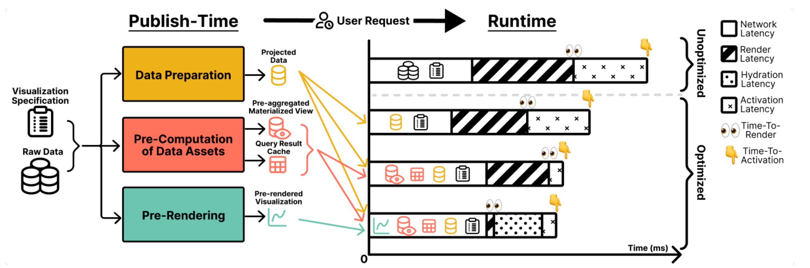
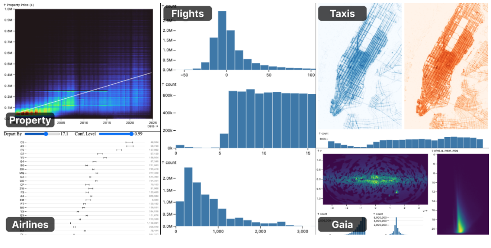
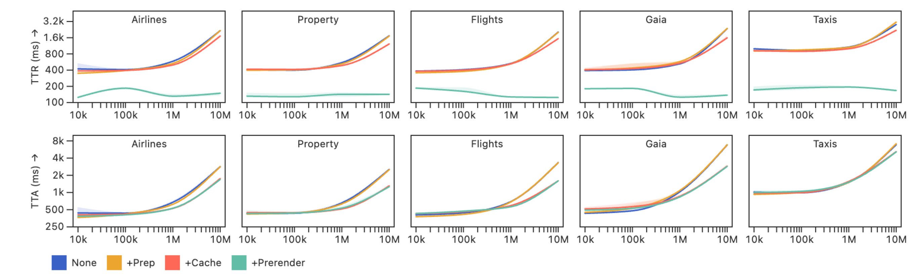
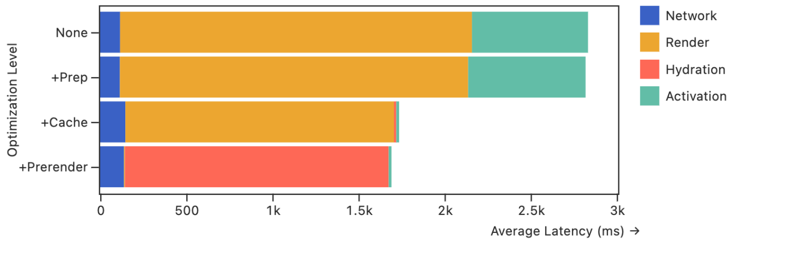

# Publish-Time Optimizations: บันทึกการอ่านและวิเคราะห์

**ผู้วิจัย:** Ron Pechuk และ Jeffrey Heer, University of Washington  
**งานประชุม:** IEEE VIS 2025 | **DOI:** 10.1109/VIS60296.2025.00051 | **IEEE Doc ID:** 11298742  
**ต้นฉบับที่อ่าน:** [PDF 5 หน้า](../01_original/Paper_IV_1_PRIMARY_PublishTimeOpt_11298742.pdf)  
**ตำแหน่งอ้างอิง:** หน้า PDF 1–5 เนื่องจากไฟล์ที่ได้รับไม่มีเลขหน้า proceedings พิมพ์อยู่บนหน้า

## ประเด็นที่ศึกษา

เว็บภาพข้อมูลแบบโต้ตอบมีงานโหลดข้อมูล คำนวณคิวรี วาดภาพ และเริ่มตัวรับอินพุต เมื่อทั้งหมดเกิดขึ้นหลังร้องขอหน้า ผู้ใช้แต่ละคนจะทำงานเริ่มต้นซ้ำ แม้กำลังดูข้อมูลและข้อกำหนดภาพชุดเดียวกัน แคชที่สร้างตอน runtime ลดภาระคิวรีถัดไปได้ แต่ผู้ใช้คนแรกยังรับต้นทุนสร้างผลเหล่านั้น

ผู้วิจัยศึกษาว่างานใดเตรียมล่วงหน้าตอนเผยแพร่ได้ แล้วพัฒนา Mosaic Publisher เพื่อเตรียมข้อมูล ผลคิวรี และภาพเริ่มต้นจาก declarative specification ประเด็นที่ศึกษาคือกลไกแต่ละส่วนสัมพันธ์กับเวลาเห็นภาพและเวลาพร้อมโต้ตอบอย่างไร ผลของชุดปรับปรุงรวมลด TTR 83.7% และ TTA 33.3% โดย SC เพิ่ม 21.2% เทียบกับ none ตัวเลขที่ลดลงไม่เท่ากันสะท้อนงานที่ยังคงอยู่หลังภาพเริ่มต้นปรากฏ (Abstract, Sections 1, 5; หน้า PDF 1, 4)

## กรอบการประเมิน

| ตัวชี้วัด | นิยามในบทความ | ขอบเขตการตีความ |
| :--- | :--- | :--- |
| TTR: Time-to-Render | จากร้องขอหน้า จนเห็น visualization ครบ | เนื้อหาภาพที่มีความหมาย ไม่ใช่เพียง header หรือ FCP |
| TTA: Time-to-Activation | จากเริ่มโหลด จนพร้อมรับ filter, zoom หรือ selection | ความพร้อมเริ่มโต้ตอบ ไม่ใช่ความหน่วงของทุกคลิกหลังเปิดระบบ |
| SC: Storage Cost | ขนาดทรัพยากรที่เผยแพร่ รวมผลที่เตรียมไว้ล่วงหน้า | เกี่ยวข้องกับพื้นที่และการโอนข้อมูล ไม่ใช่ค่า peak RAM หรือค่า CDN ที่วัดแยก |

ที่มา: Section 3.1, หน้า PDF 2

## สถาปัตยกรรม Mosaic Publisher

Figure 1, หน้า PDF 1 แยกงานสามกลุ่ม ได้แก่ data preparation, pre-computation of data assets และ pre-rendering ออกจาก user request กับ runtime

Mosaic มี coordinator กลางรับคิวรีจาก clients ของแต่ละ view และจัดการการเชื่อมโยงปฏิสัมพันธ์ Publisher อ่าน YAML เป็น Abstract Syntax Tree (AST) และใช้ virtual DOM จำลองอินพุตเพื่อค้นคิวรีที่เกิดจากการกรองหรือเลือกข้อมูล DuckDB แบบ in-process คำนวณงานตอนเผยแพร่ ส่วนระบบ runtime รองรับฐานข้อมูลผ่าน DuckDB-WASM หรือเซิร์ฟเวอร์ (Sections 3.2–3.4, 4.1–4.3; หน้า PDF 2–3)

การเตรียมข้อมูลทำ projection และ transformations ล่วงหน้า โดย rewrite AST ให้ชี้ผลข้อมูลที่สร้างไว้ ส่วน query result cache และ materialized aggregates เป็นผลที่ coordinator และฐานข้อมูลนำเข้าตอน runtime ได้ การเปลี่ยนข้อกำหนดข้อมูลเป็น explicit rewriting ขณะที่การเติมแคชและฐานข้อมูลคงวิธีเขียนคิวรีเดิมไว้

ทรัพยากรสำหรับปฏิสัมพันธ์ขึ้นกับชนิดอินพุตและสถานะที่สำรวจได้ จำนวนมิติหรือการเปลี่ยนสถานะมากขึ้นจึงมีผลต่อจำนวนทรัพยากรและต้นทุนเตรียมงาน ข้อมูลที่เปลี่ยนภายหลังทำให้ผลที่สร้างไว้ไม่ตรงกับข้อมูลใหม่ (Sections 3.2–3.4; หน้า PDF 2–3)

## Pre-rendering และ Hydration

View ที่ไม่โต้ตอบส่งเนื้อหาที่เรนเดอร์ไว้โดยไม่เพิ่มภาระ runtime สำหรับการโต้ตอบ ส่วน interactive view ส่งภาพเริ่มต้นพร้อม JavaScript ที่เติมแคช นำเข้าทรัพยากรข้อมูล และเริ่มคอมโพเนนต์โต้ตอบ

Section 4.3 ยังสร้างคอมโพเนนต์ด้วย client-side rendering ตามปกติ ต้นทุนนี้จึงไม่หายไปแม้มีภาพแสดงก่อนแล้ว Progressive hydration ปรากฏในงานที่เกี่ยวข้อง Section 2.3 ขณะที่การทำ hydration ที่ละเอียดขึ้นเป็นงานอนาคตใน Section 5 ไม่ใช่เทคนิคที่มีผล benchmark ในงานนี้ (หน้า PDF 2–4)

## การทดลองและผลที่รายงาน

Figure 2 แสดงรูปแบบภาพข้อมูลที่ใช้ทดลอง ได้แก่ airlines, property, flights, gaia และ taxis มีทั้ง view เดียวและหลาย view ที่เชื่อมปฏิสัมพันธ์กัน

ผู้วิจัยใช้ข้อมูล 10k, 100k, 1M และ 10M แถว บน MacBook Pro 14 นิ้ว ปี 2021, M1 Pro, RAM 16 GB, macOS 15.2 และ Node.js 22.9.0 ให้บริการผ่าน local server และใช้ DuckDB-WASM ในเบราว์เซอร์ ระดับ none → +prep → +cache → +prerender เป็นการเพิ่มกลยุทธ์สะสม ไม่ใช่การทดลองแต่ละเทคนิคแยกเดี่ยว (Section 5; หน้า PDF 4)

Figure 3, หน้า PDF 4 แถวบนเป็น TTR แถวล่างเป็น TTA เส้นแสดง median และแรเงาแสดง IQR แกนเวลาและขนาดข้อมูลเป็น logarithmic ผลในกราฟจึงต่างจากค่าเฉลี่ยเปอร์เซ็นต์ใน Table 1

| ระดับ | ΔSC (%) | ΔTTR (%) | ΔTTA (%) |
| :--- | ---: | ---: | ---: |
| +prep | 0.0 ± 0.0 | −0.6 ± 4.0 | −1.0 ± 2.5 |
| +cache | 21.1 ± 29.8 | −16.6 ± 1.3 | −32.3 ± 8.9 |
| +most | 21.2 ± 29.9 | −83.7 ± 2.1 | −33.3 ± 9.6 |

Table 1, หน้า PDF 4 เป็น mean ± σ ของเปอร์เซ็นต์เปลี่ยนแปลงเทียบ none ข้ามรูปแบบภาพและขนาดข้อมูล σ คือส่วนเบี่ยงเบนมาตรฐาน ไม่ใช่ confidence interval ชื่อ +most เป็นชื่อแถวในตาราง ส่วนกราฟและข้อความ Section 5 ใช้ +prerender สำหรับระดับรวมสุดท้าย

+prep ช่วยน้อยในข้อมูลที่ไม่มี transformations หรือคอลัมน์ส่วนเกิน +cache ช่วย TTA ชัด โดยเฉพาะข้อมูลตั้งแต่ 1M แถว ส่วนภาพล่วงหน้าลด TTR ได้มากกว่า TTA ผลเหล่านี้เป็นผลของกลยุทธ์สะสมภายใต้สภาพทดลองที่รายงาน

## การแลกพื้นที่กับความหน่วง

Figure 4, หน้า PDF 4 เป็นค่าเฉลี่ยส่วนประกอบเวลาของ 5 specifications ที่ข้อมูล 10M แถว แบ่ง Network, Render, Hydration และ Activation ไม่ใช่ค่าเฉลี่ยครอบคลุมทุกขนาดข้อมูล

แคชลด TTA ไปแล้ว 32.3% ส่วนชุดรวมลด 33.3% ผลต่างจึงเป็น 1.0 จุดเปอร์เซ็นต์จาก baseline เดียวกันตามการคำนวณของผู้ศึกษา ไม่ใช่ speedup 1% เมื่อเทียบกับ +cache และไม่ใช่ข้อยืนยันนัยสำคัญทางสถิติ กราฟแสดงว่าต้นทุน Hydration ของชุดรวมยังเกือบเท่าการเรนเดอร์ฝั่งไคลเอนต์เต็มชุด

SC เพิ่มเฉลี่ย 21.2% พร้อม σ 29.9 จึงมีความแตกต่างสูงระหว่างเงื่อนไข ส่วน Section 5 รายงานว่าช่วง publish ยาวกว่า unoptimized TTA ที่สอดคล้องกันเฉลี่ย 1,455.3 ± 1,779.0 ms ค่านี้เป็นผลต่างของเวลา ไม่ใช่เวลารวมของการ publish

## ข้อวิจารณ์และข้อสรุปจากการอ่าน

จุดแข็งคือมี baseline และเพิ่มกลยุทธ์เป็นขั้น ทำให้เห็นความสัมพันธ์ระหว่างงานที่ย้ายออกจาก runtime กับเวลาที่ลดลง ทั้งยังรายงานพื้นที่ที่แลกด้วย อย่างไรก็ตาม ผลมาจาก laptop เครื่องเดียวกับ local server ยังไม่ครอบคลุมมือถือและเครือข่ายช้า บทความไม่แจกแจงจำนวนรอบทำซ้ำหรือ raw measurements ใน PDF จำนวนรูปแบบภาพ ขนาดข้อมูล และระดับปรับปรุงจึงไม่ใช่จำนวนรอบรัน

ข้อสรุปจากผลทดลองคือเวลาเห็นภาพกับเวลาพร้อมโต้ตอบสะท้อนงานคนละช่วง ภาพล่วงหน้ามีประโยชน์ต่อ TTR ชัดเจน แต่ยังมีต้นทุนเริ่มส่วนโต้ตอบและพื้นที่ทรัพยากรที่เพิ่มขึ้น สถาปัตยกรรมและผลทดสอบของบทความทำให้ความแตกต่างนี้ตรวจย้อนกลับได้ โดยผลยังอยู่ในขอบเขตสภาพทดลองที่รายงาน

## แนวทางที่ทีมวิจัยเสนอ

Section 5 เสนอศึกษาวิธี hydration ที่ละเอียดขึ้นเพื่อลดต้นทุนที่ยังเกือบเท่าการเรนเดอร์ฝั่งไคลเอนต์เต็มชุด ส่วน Section 6 มองว่าข้อมูลคงที่และปฏิสัมพันธ์ที่คาดหมายได้มีโอกาสใช้วิธี publish-time ต่อไป โดยเสนอ hybrid publish/runtime strategies, incremental regeneration และการเลือก optimization configuration อัตโนมัติจากข้อมูลและข้อกำหนดภาพ ข้อเสนอเหล่านี้เป็นงานอนาคต ไม่ใช่เทคนิคที่มีผลทดลองแล้วในบทความ (หน้า PDF 4)

## เอกสารอ้างอิงและหลักฐาน

[1] R. Pechuk and J. Heer, “Publish-Time Optimizations for Web-Based Visualizations,” in 2025 IEEE Visualization and Visual Analytics (VIS), 2025, pp. 226–230, doi: 10.1109/VIS60296.2025.00051.

เนื้อหาและภาพมาจาก [ไฟล์ที่ได้รับ](../01_original/Paper_IV_1_PRIMARY_PublishTimeOpt_11298742.pdf) ซึ่งตรงกับ author copy ตาม SHA-256 และไม่มีเลขหน้า proceedings พิมพ์อยู่บนหน้า ระเบียนงานประชุมและ DOI มาจาก [ข้อมูล IEEE publisher](../00_research/evidence/publishtime-ieee-publisher-metadata.json) ขอบเขตการตรวจอยู่ใน [ตารางหลักฐาน](./claim-to-evidence.md) และ [ทะเบียนไฟล์](./evidence/README.md)
